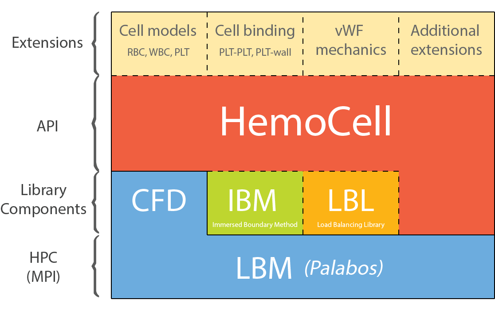

Overview: how HemoCell works
============================

HemoCell couples two solvers to simulate suspensions of deformable cells:

* a **lattice Boltzmann method (LBM)** solver for the surrounding fluid (blood
  plasma), provided by the `Palabos`_ library, and
* a **Lagrangian discrete-element** representation of each cell, whose membrane
  is a triangulated surface mesh of material points.

The two are linked by the **Immersed Boundary Method (IBM)**: the cells do not
carve boundaries into the fluid grid. Instead, the membrane points feel the
local fluid velocity and move with it, and in turn they spread their mechanical
forces back onto the nearby fluid nodes. This two-way exchange happens through a
compact interpolation kernel, so a membrane point interacts with the handful of
fluid nodes within roughly two lattice cells of it.

The simulation loop
-------------------

A single ``HemoCell::iterate()`` call advances the coupled system by
one fluid time step. Conceptually each step does the following:

#. **Interpolate** the fluid velocity onto every membrane point.
#. **Advect** the membrane points with that velocity (the cells move and
   deform).
#. **Evaluate the constitutive model**: from the new shape of each cell, compute
   the membrane forces that resist stretching, area change, volume change, and
   bending (see :ref:`concepts/cell_model:The cell model`).
#. **Spread** those membrane forces back onto the fluid nodes as a body force.
#. **Collide and stream** the fluid populations (the LBM update), which now feel
   the cell forces.

Several of these steps are expensive, so HemoCell does not necessarily run all
of them every fluid time step — see :ref:`time-scale separation
<concepts/units_and_scaling:Time-scale separation>`. The order above is
conceptual; the exact sequence of operations in the code is described in
:ref:`developer/architecture:One time step`.

The two central data structures
-------------------------------

The ``HemoCell`` object owns the whole simulation. Internally it
holds two things:

* a single Palabos **fluid lattice** (``hemocell.lattice``), the LBM grid; and
* a single **cell-fields** container (``hemocell.cellfields``), which holds the
  particle field and every cell type you have added.

You add cell types (RBC, PLT, a custom type, ...) to the cell-fields with
``HemoCell::addCellType()``, choosing both a *mechanical model* (the
constitutive behaviour) and a *construction method* (how the initial mesh is
built). The forces, interactions, load balancing, and MPI communication between
these structures are all managed by HemoCell so that, for most cases, you never
touch the parallelism directly.

   The major building blocks of a HemoCell simulation: the fluid (LBM) field,
   the cell models, and the interactions coupling them.

Where to go next
----------------

* :ref:`concepts/units_and_scaling:Units and scaling` — how physical quantities
  map onto the simulation's lattice units, and how to choose ``dx`` and ``dt``.
* :ref:`concepts/cell_model:The cell model` — how a cell is discretised and what
  forces act on its membrane.
* :ref:`concepts/parallelism:Parallelism and performance` — how a simulation is
  split across processors.
* :ref:`Creating your own HemoCell Case <Case:Creating your own HemoCell Case>`
  — put these ideas together into a runnable case.

.. _Palabos: https://palabos.unige.ch/
