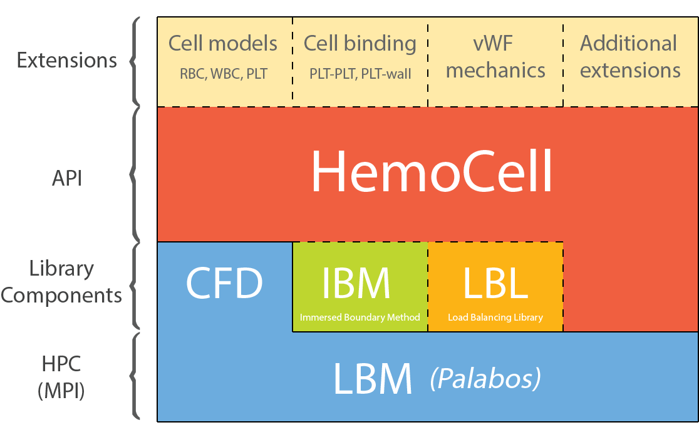
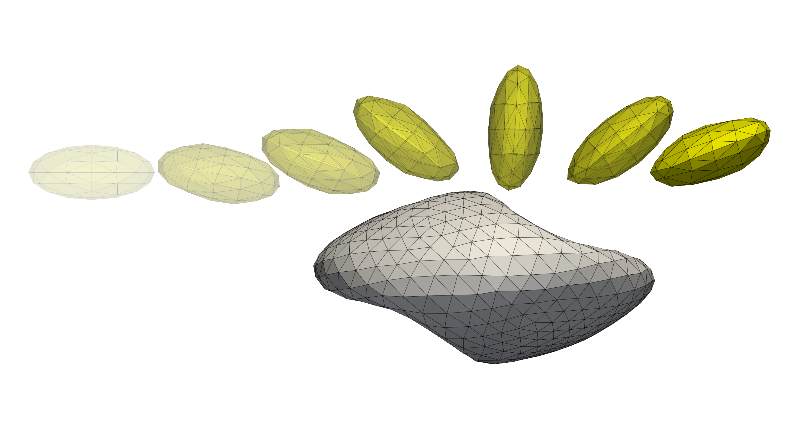
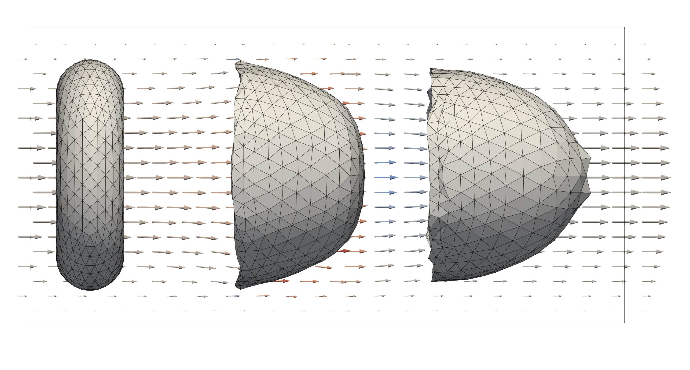
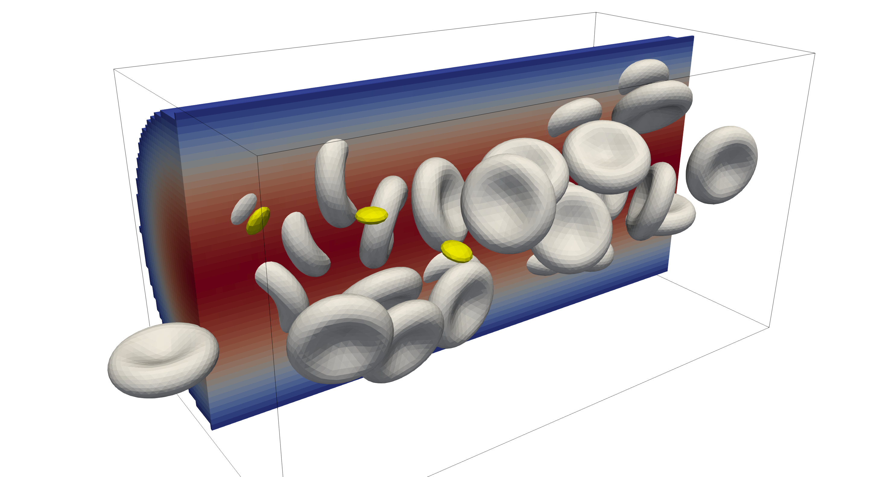
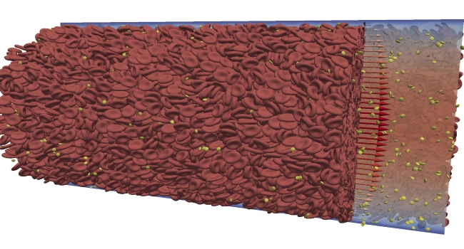

.. HemoCell documentation master file.

HemoCell
========

|

**HemoCell** (HighpErformance MicrOscopic CELlular Library) is a parallel
computing framework for the simulation of dense deformable capsule suspensions,
with special emphasis on blood flows and blood-related vesicles (cells). The
library implements validated mechanical models for Red Blood Cells (RBCs) and
is capable of reproducing emergent transport characteristics of such complex
cellular systems :cite:`Zavodszky:2017`. HemoCell handles large simulation
domains and high shear-rate flows, providing a virtual environment to evaluate a
wide palette of microfluidic scenarios
:cite:`zavodszky2019red,czaja2018cell,van2021haemodynamic`.

For the simulation of dense flows, HemoCell employs the Immersed Boundary Method
(IBM) to couple immersed vesicles — e.g. RBCs, platelets (PLTs), leukocytes, or
custom cell types — to the fluid (e.g. plasma). The cells are tracked with a
Lagrangian discrete-element approach, while the flow field is solved with the
lattice Boltzmann method (LBM), built on the `Palabos`_ library. HemoCell manages
all required data structures — materials and cell models, their interactions
within the flow field, load balancing, and inter-processor communication — so
that the parallelism is largely hidden from the user. See :ref:`concepts` for
the ideas behind the framework.

   High-level structure of HemoCell.

Where to start
--------------

.. grid:: 1 2 2 3
   :gutter: 3

   .. grid-item-card:: :octicon:`rocket;1.5em;sd-mr-1` Getting Started
      :link: QuickStart
      :link-type: doc

      Install and build HemoCell, then run and post-process your first
      simulation.

   .. grid-item-card:: :octicon:`book;1.5em;sd-mr-1` Tutorials
      :link: hemocell_cases
      :link-type: doc

      Worked example cases, from a single shearing cell to full pipe flow with
      a pre-inlet.

   .. grid-item-card:: :octicon:`light-bulb;1.5em;sd-mr-1` Concepts
      :link: concepts/index
      :link-type: doc

      The IBM–LBM coupling, units and scaling, the cell model, and how
      simulations are parallelised.

   .. grid-item-card:: :octicon:`tools;1.5em;sd-mr-1` How-to Guides
      :link: advanced_cases
      :link-type: doc

      Task-oriented recipes: custom cells, pure-flow runs, repulsion,
      visualisation, and the helper tools.

   .. grid-item-card:: :octicon:`list-unordered;1.5em;sd-mr-1` Reference
      :link: reference/index
      :link-type: doc

      Configuration tags, the HemoCell C++ API, output fields, mechanical
      models, and the full Doxygen API.

   .. grid-item-card:: :octicon:`code;1.5em;sd-mr-1` Developer Guide
      :link: developer/index
      :link-type: doc

      Internals, coding conventions, extending HemoCell, and known
      limitations.

   .. grid-item-card:: :octicon:`people;1.5em;sd-mr-1` Community
      :link: community/index
      :link-type: doc

      FAQ, common mistakes, downloads, how to contribute, and how to cite
      HemoCell.

What you can simulate
---------------------

**Single-cell mechanics.** Quick simulations (seconds to minutes, often on a
single processor) used to investigate or validate mechanical models for immersed
cells, such as :ref:`shearing <cases/onecellshear:One shearing cell>`,
:ref:`stretching <cases/stretchcell:One stretching cell>`, or
:ref:`"parachuting" <cases/parachuting:A parachuting cell>` of a single cell, or
the interaction between
:ref:`colliding cells <cases/cellCollision_interior_viscosity:Colliding cells with interior viscosity>`.

**Bulk flows.** Large domains with many immersed particles, typically derived
from straight-channel flow. These range from quick runs on a workstation to
long simulations on HPC clusters with thousands of cores. See
:ref:`cases/pipeflow:Pipe flow` and
:ref:`cases/pipeflow_with_preinlet:Pipe flow with periodic inflow`.

.. admonition:: Citing HemoCell
   :class: tip

   When using HemoCell, please cite the corresponding HemoCell paper(s). See
   :ref:`citing` for details.

.. Hidden top-level navigation. The sidebar is generated from the captions
.. below; the landing page itself uses the cards above for navigation.

.. toctree::
   :caption: Getting Started
   :maxdepth: 2
   :hidden:

   QuickStart
   Case

.. toctree::
   :caption: Tutorials
   :maxdepth: 2
   :hidden:

   hemocell_cases

.. toctree::
   :caption: Concepts
   :maxdepth: 1
   :hidden:

   concepts/index

.. toctree::
   :caption: How-to Guides
   :maxdepth: 1
   :hidden:

   advanced_cases
   packcells
   visualization
   helper_scripts
   utilities

.. toctree::
   :caption: Reference
   :maxdepth: 1
   :hidden:

   reference/index

.. toctree::
   :caption: Developer Guide
   :maxdepth: 1
   :hidden:

   developer/index

.. toctree::
   :caption: Community
   :maxdepth: 1
   :hidden:

   community/index

.. _Palabos: https://palabos.unige.ch/
